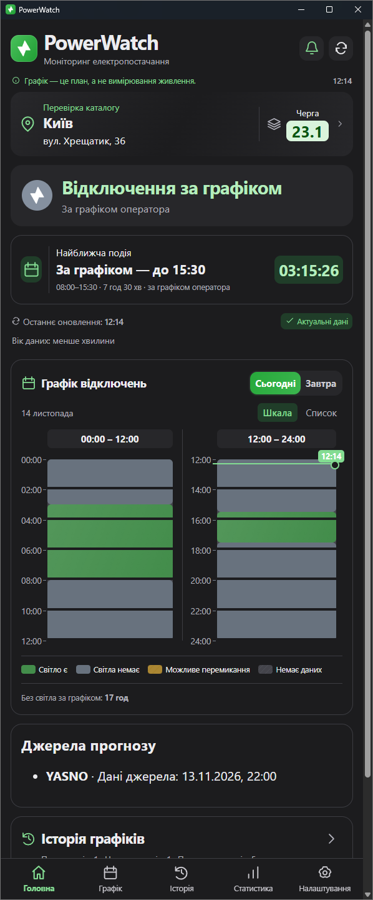

# PowerWatch

Локальний застосунок для Windows та Android: графіки відключень, кілька адрес, історія змін, семиденна статистика й системні сповіщення. Автор — **bostech**.

PowerWatch — незалежний проєкт, не офіційний застосунок ДТЕК, YASNO чи інших операторів. Графік — це план, а не вимірювання живлення.



## Встановлення й оновлення

Готові APK та Windows-інсталятор, опис змін і підписані маніфести шукайте у [GitHub Releases](https://github.com/Realtek95/PowerWatch-public/releases). Історія оновлень українською — у [CHANGELOG.md](CHANGELOG.md). Код у `windows/` та `android/` є окремими зрізами єдиної реалізації; інсталяційні файли до Git не додаються.

Потрібні Windows 10/11 x64 або Android 9 та новіший. Телефонний APK — ARM64. Android запитує дозвіл сповіщень при першому запуску. Оновлення перевіряють підпис, розмір, SHA-256 та відповідність платформі; встановлення підтверджується користувачем у штатному інсталяторі. Власні збірки можуть мати інший підпис і не встановляться поверх офіційного APK. Перевірка версії читає підписаний `powerwatch-update.json`; застосунок пропонує встановлення лише новішої версії. Інсталяційні пакети вже доступні у випусках; окремий каталог адрес поки не опублікований.

Для Android доступ до інтернету надається під час установлення. Якщо система обмежує фонові дані або батарею, відкрийте «Налаштування фонової роботи» в застосунку. Локальні нагадування використовують збережений план; час виконання у фоні залежить від ОС.

## Дані й покриття

| Можливість | Межі |
| --- | --- |
| Адресний довідник | 27 територій КАТОТТГ, район/громада/населений пункт, вулиці й будинки з НАІС, ДРВ та OSM. Це підготовлений зріз, який не містить усіх будинків України |
| Адресний статус | Прямий канал ДТЕК Дніпровські електромережі: точно зіставлені населений пункт, вулиця й будинок без окремого корпусу; залежить від доступності сайту |
| Черга за адресою | Прямий ДТЕК та підтримані довідники YASNO; невідомі або неоднозначні адреси не отримують вигаданої черги |
| Графік черги | YASNO, SvitloPulse та датоване резервне дзеркало, лише для фактично доступного оператора/черги/дати |
| Тимчасова відсутність даних | Зберігаються останній доступний план і його початковий час; помилка отримання та давність даних оцінюються окремо, повторні спроби мають паузи |
| Непідтримана адреса | Можна зберегти введений текст; підтверджений оператор/черга/графік не вигадуються |

Однакові назви населених пунктів різних громад не об’єднуються. Поля можна заповнити вручну або вибрати з підказок. Ручний вибір черги не підтверджує її належності будинку. Оціночний час завершення адресного відключення не означає фактичного відновлення електропостачання. Наживо перевірено прямий канал без активної події; аварійні варіанти додатково перевірялися контрольованими даними.

Основні джерела: [ДТЕК](https://www.dtek-dnem.com.ua/ua/shutdowns), [YASNO](https://static.yasno.ua/dnipro/outages/), [SvitloPulse](https://svitlopulse.andrewboyko.name/api/). Походження адресного каталогу та ODbL — у [DATA_LICENSE.md](DATA_LICENSE.md). Права на первинні дані належать їхнім правовласникам; наявність запису в адресному довіднику не підтверджує покриття графіками.

## Робота у фоні й конфіденційність

Автоматичні перевірки виконуються послідовно, з п’ятисекундною паузою між адресами. Типово — 07:00–00:00; години й частота налаштовуються. Ручне оновлення доступне окремою кнопкою й поза налаштованими годинами. Якщо виконавець зайнятий або триває пауза, запит очікує виконання; повторні натискання не накопичують перевірки. Серверні обмеження та Retry-After зберігаються. Перегляд сьогодні/завтра або віджета сам по собі не опитує джерела.

Android має чотири віджети: малий 2×1, середній 3×2, великий 4×2 і почасовий графік 2×2, зі світлою та темною темами. Остаточні клітинки визначає робочий стіл телефона.

Android використовує WorkManager і локальні нагадування. ОС може відкласти роботу через економію батареї; після примусової зупинки необхідний звичайний запуск застосунку. Windows перевіряє дані, доки працює процес; доступні трей і автозапуск. Сповіщення можуть бути приховані системними налаштуваннями. Власного сервера та віддалених push немає.

Адреси, налаштування, кеш та історія зберігаються локально в SQLite. Немає облікових записів, аналітики, FCM чи хмарної синхронізації. Під час визначення адреси/статусу відповідне джерело отримує місто, вулицю та номер будинку; для групового графіка — оператора та чергу. Перевірки оновлень звертаються до GitHub. Програма не переносить cookie браузера й не обходить захист сайтів.

## Збірка з коду

Кожен каталог платформи містить самостійний Rust workspace та frontend. Потрібні Git, Python 3.11+, Node.js 24.22.1, pnpm 11.25.0, Rust із `rust-toolchain.toml`. Для Windows потрібні Visual Studio C++ Build Tools та WebView2. Для Android — Android Studio/JDK, SDK 37, NDK 30.0.16248370 та Rust target `aarch64-linux-android` (або `x86_64-linux-android` для емулятора). Версії інструментів зафіксовані у файлах збірки.

Завантажте `PowerWatch-address-catalog.zip` із ресурсів відповідного випуску та покладіть поряд із каталогами `windows/` і `android/`. Цей великий файл не додається до Git. До окремої публікації каталогу збірка доступна лише за наявності локальної перевіреної копії цього ресурсу; сам код не містить повної адресної бази. Код перевіряє його SHA-256, склад, обласні розміри та хеші розпакованих SQLite; довільна інша версія пакета не приймається. Великі XML/PBF під час запуску не обробляються.

Windows, PowerShell із каталогу репозиторію:

```powershell
cd windows
python scripts/Install-Catalog.py ../PowerWatch-address-catalog.zip
pnpm install --frozen-lockfile
. ./scripts/Enter-Environment.ps1
pnpm tauri build
```

Інсталятор з’явиться у `windows/target/release/bundle/nsis/`.

Android, PowerShell із каталогу репозиторію:

```powershell
cd android
python scripts/Install-Catalog.py ../PowerWatch-address-catalog.zip
pnpm install --frozen-lockfile
. ./scripts/Enter-Environment.ps1
rustup target add aarch64-linux-android
./scripts/Build-Android.ps1 -Target aarch64 -Configuration Debug
```

Debug APK підписується локальним ключем Android SDK. Для власного Release задайте `PW_ANDROID_KEYSTORE_FILE`, `PW_ANDROID_STORE_PASSWORD`, `PW_ANDROID_KEY_ALIAS`, `PW_ANDROID_KEY_PASSWORD` лише у поточному процесі й виберіть `-Configuration Release`. Без цих змінних Release залишається непідписаним. Ключі випуску не входять до коду. Скрипт має перевірений резервний шлях пакування у Windows без права створення символічних посилань.

Для перевірки типів: `pnpm typecheck`; форматування Rust: `cargo fmt --all -- --check`. У каталозі `windows` аналіз Rust: `cargo clippy --all-targets -- -D warnings`; Android-код компілюється для вибраної цілі під час Android-збірки. Внутрішні тести й контрольні набори не входять до цього публічного зрізу.

Код — [MIT](LICENSE); умови компонентів і їхні notices зберігаються поряд із кожною платформою. Повідомлення про помилки й контакт — [сторінка проєкту](https://github.com/Realtek95/PowerWatch-public). Не додавайте до публічних звітів домашні адреси, бази даних, токени чи ключі.
